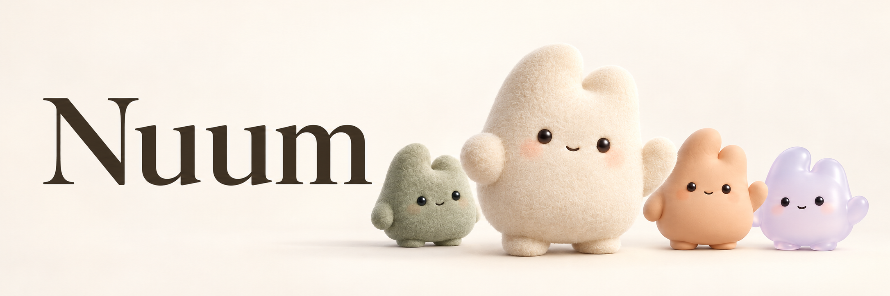

# Nuum

Nuum is a local-first desktop app for persistent AI companions called Nunu.

Each Nunu has its own identity, memory, and workspace. Work with one directly, bring several together to discuss an idea, or give them tasks to carry out and return for your review.

## What you can do

- **Build an ongoing working relationship.** Each Nunu keeps its identity and memory across conversations and tasks.
- **Work with local tools.** Nunu can work with files, search, and run shell commands under configured permissions.
- **Bring Nunu together.** Create a Room for discussion, then upgrade it to a NunuBar when you need task cards and deliverables.
- **Choose your model provider.** Connect DeepSeek, OpenAI, or Anthropic.

## Room / NunuBar

A Room is a shared conversation with your Nunu. The same Nunu can participate in multiple rooms; mention specific members to direct a question, or address the group.

Upgrade a Room to a **NunuBar** to turn discussion into work without losing its members or history. Task cards keep ownership, progress, and results together. A Nunu can delegate work to another member while remaining responsible for the result, and finished work comes back for your review.

Collaboration currently runs locally. Cross-user collaboration is planned.

## Local-first, with your control

Nuum stores agent history, memory, and workspaces locally. You choose the model provider and configure permissions for tools. Model requests send the context needed for a task to your configured provider.

You review deliverables, confirm how to proceed when work is blocked, and explicitly resume interrupted work whose outcome is uncertain.

## Project status

Nuum is under active development. Persistent Nunu, local tools, Rooms, and NunuBar task collaboration are implemented. Broader end-to-end validation with real models and external tools is still in progress.

**Proactive Mode** currently provides menu-bar controls and per-Nunu settings. Context collection, model evaluation, and proactive actions are not connected yet.

For architecture, validation details, and current limits, see the [Room / NunuBar documentation](./docs/workbar/foundation.md), [validation notes](./docs/workbar/implementation.md), and [Proactive foundation](./docs/proactive/foundation.md).

## Repository map

```text
apps/desktop       Electron shell and renderer mounting
packages/ui        React interface
packages/host      Agent state, transcripts, memory, permissions, scheduling
packages/kernel    Model loop and tool execution
packages/protocol  Shared RPC and domain contracts
packages/tools     Built-in tools
packages/sandbox   Local execution boundary and persistent shells
docs               Architecture and engineering records
```

## Development

Requirements: Node.js 22 or newer and pnpm 10.

```bash
pnpm install
pnpm dev
pnpm typecheck
pnpm test
pnpm run lint:deps
```

Start with [AGENTS.md](./AGENTS.md) for the project map and [docs/coding](./docs/coding/README.md) before changing product behavior.

## License

Licensed under the [Apache License 2.0](./LICENSE). Third-party dependencies and assets remain subject to their respective licenses and attribution requirements.
