# Nuum 品牌、Nunu 外观与动画规范

> 状态：已确认（2026-10-17）。
> 适用范围：Logo、宣传素材、创建预览、头像、资料卡及 Nunu 状态动画。
> 本文的「必须」是验收要求；「当前实现」仅记录现状，不代表全部视觉效果已经验收。

## 1. 品牌与角色身份

- **Nuum** 是产品名称；**Nunu** 是产品中的持久角色。正文采用此大小写，字标可使用 `NUUM`。
- Nunu 的识别特征：不对称的小写 n 形顶部（左高右低）、柔和饱满的轮廓、两只深色眼睛与简洁嘴部。全身形象具有短手臂与短脚。
- 材质、颜色、体型可以变化，但必须保留同一家族的识别特征。不得随机换脸、改变左右顶部关系，或退化为仅有颜色区别的同一张图。
- 静态宣传图可以使用不同姿态；不能直接把彼此不连续的 AI 姿态图当作合格动画帧。

## 2. Logo 与品牌素材

### 2.1 当前参考

| 资产 | 用途与现状 |
| --- | --- |
| [nuum-logo-v1.png](../../output/brand/nuum-logo-v1.png) | 新版 Logo 形象参考：奶油色、哑光立体质感、n 形顶部、深色眼睛与微笑；不带全身四肢 |
| [nuum-banner-v1.png](../../output/brand/nuum-banner-v1.png) | 品牌横幅参考：暖白底、左侧 Nuum 字标、右侧多材质 Nunu 家族 |
| [docs/assets/nuum-banner.png](../assets/nuum-banner.png) | README 当前使用的横幅 |
| [nuum-logo.svg](../../apps/desktop/resources/nuum-logo.svg) | 旧绿色圆团、白色双眼资源；与新版参考不一致，仍待单独迁移，不能作为新版角色造型依据 |

### 2.2 使用要求

- 品牌 Logo 使用固定形象，不随成员随机颜色、材质或运行状态改变。
- 缩放 Logo 必须等比，保留完整轮廓和透明边缘；不得压扁、拉长、镜像或裁掉顶部。小尺寸不可直接从横幅截图提取。
- 浅色、深色背景均须检查边缘，不得出现白边、脏色、锯齿或背景残留。透明素材不能携带烘焙的棋盘格。
- 横幅保持原始比例、字标与角色的相对布局；界面中的品牌字标不能用任意字体近似替代已有图形字标。
- 当前尚无经确认的独立矢量字标、Logo 安全区数值或最小印刷尺寸；不得把横幅中的字体猜测写成正式字体规范。
- 本文只确定参考与使用约束，不声称桌面图标、菜单栏图标和所有品牌入口已迁移完成。

## 3. Nunu 外观数据与一致性

- 外观真源为协议和 Host 持久化的 `avatarColor`、`avatarShape`、`avatarMaterial`。显示组件必须完整传递三项，不能只读取颜色。
- 创建时生成外观，保存后稳定绑定该成员；刷新、换页、播放动画不能重新随机。修改外观后，各显示位置必须同步。
- 颜色、材质、形状是独立维度。当前普通池为 **7 色 × 4 材质 × 5 形状 = 140 个参数组合**，不是 140 张独立绘制的原图。
- 创建预览与资料卡必须显示相同外观。小头像允许为辨识度简化纹理，但必须尊重相同的颜色、材质与形状身份。
- 当前定义集中于 [nunu-appearance.ts](../../packages/ui/src/conversation/nunu-appearance.ts)。不得在其他组件另建默认毛绒图或独立随机规则。

### 3.1 材质

| ID | 材质 | 必须能辨认的特征 |
| --- | --- | --- |
| `plush` | 毛绒 | 蓬松短绒、柔软边缘与漫反射；细节不能糊成无纹理色块 |
| `felt` | 毛毡 | 紧实的细纤维表面，轮廓比毛绒更收敛；不能只是毛绒换色 |
| `matte` | 哑光 | 平滑实体表面、柔和明暗与有限高光；不应出现毛发纹理 |
| `glass` | 蛋白石玻璃 | 乳白半透、柔和宽高光、干净的透光边缘；禁止深色镜面反射块、浑浊棕黄与胶状油腻感 |

`aurora` 是兼容保留值，目前映射到玻璃素材，不进入普通随机池；不视为已完成的第五种独立材质。

### 3.2 颜色

以下为当前色板基准；实际材质还包含光照、高光与阴影，不要求每个渲染像素等于色值。

| ID | 名称 | 基色 | 小头像阴影色 |
| --- | --- | --- | --- |
| `cream` | 奶油 | `#f3e8d4` | `#c8af8b` |
| `green` | 鼠尾草绿 | `#bac8a8` | `#7e9270` |
| `orange` | 杏桃 | `#f4c2a1` | `#ce8e6a` |
| `violet` | 淡紫 | `#d5c6eb` | `#a28dbd` |
| `blue` | 雾蓝 | `#bedce7` | `#7cabbf` |
| `magenta` | 柔粉 | `#eec3cc` | `#bd899b` |
| `honey` | 蜂蜜 | `#efdb9b` | `#c1a456` |

- 变色必须保留材质明暗、眼睛与嘴的对比、高光及透明度，不可覆盖成一层不透明纯色。
- 玻璃采用浅染色，保持乳白透光主体；蜂蜜色不得变成深琥珀或棕褐色。当前玻璃染色强度为普通材质的 38%，是可调基线。
- 兼容旧 `black` 值：当前映射 `#a7aaa8` / `#707873`，不进入普通随机池。
- 缺失或未知颜色、形状使用成员 ID 的稳定回退；缺失或未知材质当前回退毛绒。合法持久化值不得被回退覆盖。

### 3.3 形状

| ID | 轮廓方向 |
| --- | --- |
| `blob` | 基础柔软团状、自然不对称 |
| `circle` | 更圆润、重心稳定的饱满体型 |
| `droplet` | 上窄下宽、更修长的水滴体型 |
| `cloud` | 横向舒展、肩部柔和的云团体型，保留自然身高 |
| `tablet` | 肩部较宽、下缘收敛的圆角块状体型，不能压成扁片 |

- 相同颜色和材质下，形状仍必须能通过轮廓分辨，不能只改尺寸或文件名。
- 禁止用整体纵向压缩冒充体型差异。当前所有全身轮廓的高度系数限制为原图的 0.98–1.02，差异主要来自轮廓宽度分布；眼睛和四肢不能被压扁。
- 五种轮廓都保留 n 形顶部；脸、四肢和身体保持合理比例，不得裁掉脚或拉裂肩部。
- 当前全身形象通过原图的连续网格轮廓变形实现，小头像使用各自的 SVG 轮廓；这是实现方式，不等于已经拥有五套独立建模资产。

## 4. 高清渲染与素材管理

- 运行时正式位图位于 `packages/ui/src/assets/nunu/`，当前只使用 `plush.png`、`felt.png`、`matte.png`、`glass.png` 四张高清原图。
- `output/brand/nunu/` 用于保存品牌原图、参考和历史实验，并由 README 标明哪些在用、哪些已停用。AI 生成素材应保留可获得的来源、模式和提示词；未知来源不补造。
- 不得拿 256px 姿态图格放大作为资料卡主形象，也不得用重复放大、模糊滤镜或低质量重绘掩盖素材缺陷。
- 资料卡画布实际像素密度至少为 `max(2, devicePixelRatio)`；原图应能覆盖实际显示所需像素。窗口、DPI 或缩放变化后重新检查清晰度。
- 当前直接上传原始纹理，在着色器中变色；这一技术选择可替换，但静止和运动中的轮廓、眼睛、纹理不能明显劣于原图直接显示。
- 深浅背景检查透明边缘；材质检查必须看实际尺寸，不能仅以图片文件尺寸或 canvas.width 宣称清晰。
- 静止时停止逐帧绘制。图形能力不可用时显示静态回退；回退也应保持成员身份，不能无提示地换成另一种材质。

## 5. 资料卡布局与跟随

- 卡片跟随指针；圆盘和 Nunu 必须在独立层中，基本保持稳定，不继承卡片的大幅摆动。
- 当前调校基线：卡片最大约 ±9°、响应时间常数 85ms；圆盘最大约 ±0.6°、响应时间常数 420ms。允许后续调校，但必须维持明显不同的幅度和响应速度。
- 圆盘及 Nunu 在卡片中居中；除容器几何中心外，还需检查不同体型的视觉重心。
- 当前 Nunu 容器为 `min(212px, 82%)`，圆盘文字为 SVG 200×200 坐标中的 8.5px。调整以形象辨识优先，文字不得挤占形象或遮住动作。
- 点击 Nunu 触发动作，点击卡片其他编辑区域打开资料编辑；不要嵌套按钮或让两个操作互相误触。

## 6. 动画标准

### 6.1 连续性与节奏

- **至少 45fps，目标 60fps**。按实际角色重绘的时间间隔测量，不能把视频声明帧率、rAF 回调数或插入重复帧当作有效动作帧率。
- 帧率合格不等于视觉合格：动作必须及时启动、节奏清楚、姿态连续。不能以慢速移动掩盖缺帧。
- 点击后 150ms 内应出现可辨识动作。当前六组单次动作基线为 0.9–1.4 秒，起手明确、收尾平滑。
- 必须编排眼睛、视线、手臂、头部或脚部的局部动作；仅对整张图片拉伸、放缩或左右旋转不算角色动画。
- 同一动作全过程保持同一张脸、材质、颜色和轮廓身份；不得中途跳换表情、光照或纹理。
- 肩部与身体始终连续；禁止可见硬裁切、透明裂缝、脱落手掌、贴片色差和穿帮。网格变形也需检查是否折叠或拉扯纹理。

### 6.2 当前六组交互与待机动作

| 动作 | 时长基线 | 动作内容 |
| --- | --- | --- |
| `wave` | 900ms | 连续挥手，配合轻微头部与视线动作 |
| `think` | 1250ms | 左右张望、手臂轻微内收、眨眼与头部响应；限制内收幅度，避免网格折叠 |
| `cheer` | 1050ms | 双手举起、两次小跳、脚部与笑容配合 |
| `sleepy` | 1400ms | 闭眼、点头、身体下沉后恢复 |
| `nod` | 1100ms | 两次轻点头、视线下移、眨眼与微笑 |
| `sway` | 1300ms | 左右轻摆、视线跟随、手臂与脚部响应 |

点击与待机共用六种动作的洗牌池，每轮不重复，轮次交界避免同动作连播。动作完成后静止 2.8–6 秒，再自动触发下一次；隐藏窗口、关闭卡片或开启减少动态效果时停止待机计时。

五官关节按材质原图分别标定，眼球与反光边缘必须完整落在局部变形的内部区域；玻璃使用更小的手脚旋转幅度，避免高光轮廓被拉扯。参数集中于 [nunu-rig-profile.ts](../../packages/ui/src/conversation/nunu-rig-profile.ts)。

动画实现位于 [nunu-animation.ts](../../packages/ui/src/conversation/nunu-animation.ts)、[nunu-rig.ts](../../packages/ui/src/conversation/nunu-rig.ts) 和 [nunu-portrait.tsx](../../packages/ui/src/conversation/nunu-portrait.tsx)。不要求永久使用 WebGL，但替代实现必须满足上述视觉标准。

### 6.3 连点、状态与生命周期

- 连点不能重置正在播放的关节姿态，也不能产生无限队列。当前策略：当前动作播放完，最多保留一个待播动作，后续点击更新待播项。
- 连点结束后必须回到静止，并能再次响应点击。切换成员、关闭资料卡、隐藏窗口后不能留下旧动作或定时器。
- 尊重 `prefers-reduced-motion`：停止装饰动画和指针倾斜，保留静态形象及可操作的资料编辑入口。
- 运行状态以当前 runtime 和实时工具状态为准；历史工具记录不能让已空闲的成员持续显示工作动画。等待审批、错误、思考、执行须区分。
- 上下文丢失或素材加载失败不得导致整张资料卡不可用；恢复后不能同时运行多个播放循环。

## 7. 验收与提交证据

每次修改外观或动画，至少完成：

1. 创建预览、保存后的资料卡、小头像、NunuBar 成员显示核对三项外观字段；已有成员刷新后身份不变。
2. 检查 4 种材质、5 种轮廓；使用相同颜色对比材质、相同材质对比轮廓，避免只凭随机预览下结论。
3. 在实际 Electron 窗口检查静止、动作极值、动作切换、窄窗口、深浅主题及高 DPI 下的清晰度、居中和边缘。
4. 六组动作分别测量有效帧率并检查帧间隔；记录环境和异常长帧，不仅报平均值。测试至少 50 次连点及再次点击。
5. 检查减少动态效果、后台停止和重新打开资料卡。
6. 运行 `pnpm typecheck`、相关测试、`pnpm run lint:deps`、桌面构建；遵循 [测试规范](./tdd.md)。修改协议或 Host 时扩大验证范围。

当前已知仍需关注：旧桌面 Logo 资源未迁移；小头像采用简化材质表现；五种全身轮廓是网格变体；跨硬件持续帧率与所有主题、DPI 的完整矩阵不能由单机一次测试替代。后续提交必须如实记录覆盖范围，不把本规范清单自动标记为通过。
