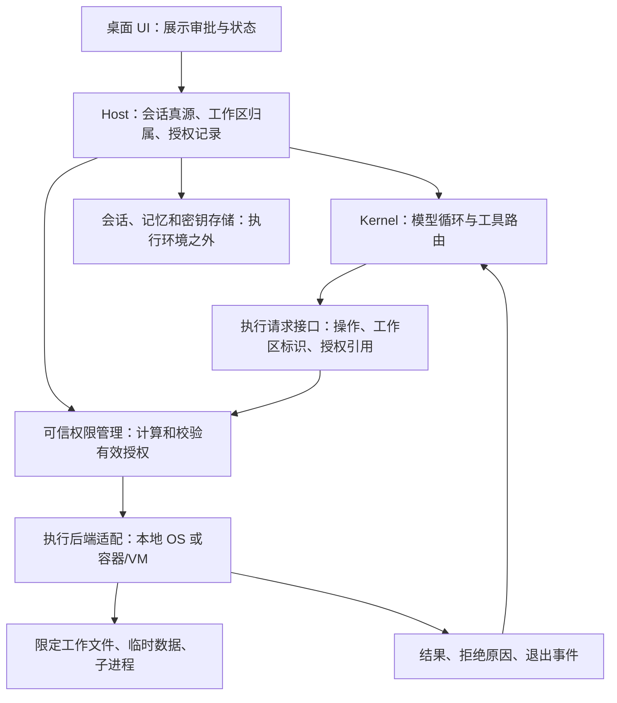

# Agent 沙箱架构研究与 Nuum 回退说明

日期：2026-10-19。状态：**供 review；未选定后端，未授权实施新沙箱。**

本报告依据官方文档、官方开源仓库和本地 Grokbot 重建源码。产品文档为本次访问内容，不代表所有历史版本；Grokbot 的“接口存在”与“底层实现已验证”分开表述。没有以第三方文章作为实现结论的依据。

## 1. 本轮回退结果

已经撤销上一轮新增的系统沙箱、联网代理、联网审批契约、只读搜索进程、CLI 迁入 Kernel、shell 生命周期调整、执行目录锁条件调整，以及与这些改动耦合的自动目录分配/迁移。不是把新沙箱关闭后留在代码中，而是恢复对应文件到此次实现前的版本，删除新增模块。

- 29 个跟踪文件恢复；9 个新增源码/测试/说明文件删除；32 个对应残留编译文件清除。
- 对 3 个混合 UI 文件逐项撤回沙箱内容，保留产品 UI 调整。
- 保留：移除“N 工作中”、NunuBar 设置菜单及其中的目标编辑；客户端设置不再显示个人项目目录；设置分组名为“本地工具权限”。
- 另发现上轮 UI 遗漏：新建 NunuBar 页面仍有原有的目标输入框；本轮按“先前 UI 调整不变”没有另行修改它。它不再注入 Work 目标提示词，这个遗留应单独 review，不能宣称目标字段已在所有页面移除。
- 保留：之前的六种动画、随机待机及材质/形变修正；23 个动画相关文件的 SHA-256 与回退前相同。
- **文稿/Nuum 自动目录分配暂不生效**，它仍是用户要求，须在目录归属与隔离设计确定后独立实施。私人会话默认根、NunuBar 根、scratch 和终端目录恢复原逻辑。
- 正式 `~/Library/Application Support/@nuum` 下未发现 `workspace-before-managed.json` 标记。没有删除或搬移用户工作文件，也没有对历史数据做盲目反向迁移。
- 回退前源码、补丁、清单备份：`/tmp/nuum-sandbox-rollback-20261019/`。这是临时恢复材料，不是提交或发布产物。

**回退也恢复了旧版执行能力的局限：不能再宣称 Nuum 已具备本轮实现的 OS 隔离或默认断网。** 旧 `packages/sandbox` 是原有权限/路径检查代码，不是这轮新增系统沙箱的残留。

### 提示词与 tool 的明确变更清单

| 项目 | 回退后的状态 | 理由 |
|---|---|---|
| 默认断网、联网代理、隔离 HOME、工作根限制说明 | 撤回，恢复原提示词 | 新机制已撤销，不能留下不真实的模型说明 |
| profile/settings 必须由 Host 管理的新提示 | 撤回 | 随新文件边界一起恢复 |
| Work 上下文中的 `Goal:` | **保留删除**；唯一剩余的后端提示词 diff | 对应用户移除 NunuBar 目标的要求；不让不可编辑的旧目标继续指导模型 |
| `shell.network_access`、`RunWorkCLI.network_access` | 删除，恢复原 schema | 不保留不存在的联网审批能力 |
| `network-command` 动作、Work 审批事件和 UI | 删除 | 属于本轮沙箱新增链路 |
| `RunWorkCLI` 执行位置 | 恢复 Host 原实现 | 撤销未经 review 的进程边界迁移 |
| `update_state target=settings` | 恢复原有契约与处理函数 | 完整撤回目录协议重构；这不是新增加能力 |
| `AgentSettings.workspace.projectRoot` | 恢复旧 schema，UI 入口仍隐藏 | 保持回退后协议兼容；修改工具权限不会清除已存目录 |
| 文件、搜索和 shell 工具实现 | 恢复此前版本 | 不留下与旧策略不一致的部分执行器 |

因此，“目标 UI 删除”不等于删除所有旧持久化字段；“项目目录入口隐藏”也不等于完成目录领域模型重构。后续若要永久删除旧字段或 `update_state` 分支，必须在协议迁移清单中先说明。

## 2. 需要先区分的四件事

1. **授权策略**：谁可读写什么、是否可联网、授权持续多久。
2. **审批交互**：超出当前授权时，用户批准的是哪个具体请求。
3. **强制执行**：OS、容器或 VM 如何使进程无法绕过授权。
4. **生命周期和数据归属**：工作文件、会话日志、密钥、进程退出与恢复分别由谁管理。

提示词描述权限，不执行权限。单独 daemon 解决进程职责和生命周期，并不天然形成安全边界。创建独立文件夹也不等于禁止访问兄弟文件夹。容器隔离、联网控制和密钥保护仍是不同问题。

`sandbox-exec` 是 macOS 用于按 Seatbelt 规则启动进程的程序，不是 VM，不提供文件回滚。选择它本身并非错误；上一轮的错误是未先确定上述边界便把平台规则、产品目录、审批和模型工具一起改了。

## 3. 主流实现实际如何设计

### 3.1 Codex：审批与 OS 强制执行分离

本地命令在平台沙箱中执行；macOS 使用 Seatbelt，Linux/WSL 使用 bubblewrap，Windows 有原生实现。审批决定何时扩大授权，沙箱决定实际可访问的资源，普通项目内操作无需逐条弹窗。不能把“无需审批”解释为“没有沙箱”。见 [官方沙箱说明](https://learn.chatgpt.com/docs/sandboxing)。

网络策略另外处理；命令代理不覆盖模型请求、MCP、浏览器等全部网络入口。这意味着必须逐一标出受控面，不能用一个 network 开关承诺整个 agent 都断网。见 [官方权限与网络说明](https://learn.chatgpt.com/docs/agent-approvals-security)。

**对 Nuum 的启示（设计判断）：** Host 审批和执行器强制执行应共享明确的授权对象，但分别承担职责。不能把所有本地工具权限折叠成 `always/ask/never` 后再到处补特殊分支。

### 3.2 Claude Code：本地工具沙箱与可复用 runtime

Claude Code 将工具权限检查与命令的 OS 隔离区分。其 Bash 沙箱在 macOS 用 Seatbelt，在 Linux 用 bubblewrap；网络通过沙箱外代理按域名判断。工具必须使用代理，允许域名不等于允许任意直连。它也存在受配置控制的非沙箱执行路径，不能笼统说所有模式始终强隔离。见 [官方 sandbox 文档](https://code.claude.com/docs/en/sandboxing)。

Anthropic 将沙箱实现作为独立 runtime 开源，包含策略 schema、平台适配、代理和拒绝追踪；它不是 Claude 会话/业务领域模型的一部分。见 [sandbox-runtime 官方仓库](https://github.com/anthropics/sandbox-runtime)。

**对 Nuum 的启示（设计判断）：** 可复用 runtime 值得评估，但必须先确定版本、许可证、支持平台、拒绝行为和工具覆盖范围。不能把包存在等同于已验证可替换，也不能把“自动退到非沙箱”照搬为 Nuum 默认行为。

### 3.3 Gemini CLI：同一产品选择不同执行后端

官方文档提供 Seatbelt、Docker/Podman 等方式。容器模式挂载工作目录；还区分整进程隔离与工具级隔离，并支持为一次执行请求扩展权限。不同后端和 profile 的权限不同，例如所列 Seatbelt 默认 profile 允许网络；“启用沙箱”并不等于“默认断网”。见 [官方仓库 sandbox 文档](https://github.com/google-gemini/gemini-cli/blob/main/docs/cli/sandbox.md)。

**对 Nuum 的启示（设计判断）：** 后端应报告实际支持的文件、网络和进程控制能力。用户的“默认禁止联网”必须是 Nuum 的明确策略，不能依赖后端默认值。迁移到容器时，工具不应重新承担路径映射和容器发现。

### 3.4 OpenHands：Workspace 抽象与 Agent Server

SDK 通过 Workspace 接口连接本地、Docker 或远端环境；远端路径通过 HTTP/WebSocket 控制 Agent Server，提供命令与文件操作及事件。业务会话调用不需要因换后端而全部重写。见 [官方 Agent Server 架构](https://raw.githubusercontent.com/OpenHands/docs/main/sdk/guides/agent-server/overview.mdx)。

DockerWorkspace 管理拉取镜像、启动、等待服务就绪和清理；Agent Server 本身可运行在容器中。这与“模型循环必然在容器外”不是同一设计。见 [官方 Docker Sandbox 文档](https://raw.githubusercontent.com/OpenHands/docs/main/sdk/guides/agent-server/docker-sandbox.mdx)。

**对 Nuum 的启示（设计判断）：** 统一执行接口和生命周期是值得采用的分层方式。容器本身不能替我们决定跨 NunuBar 权限、网络审批、密钥注入以及共享文件冲突。

### 3.5 Anthropic Managed Agents：会话、模型循环、执行环境分离

官方文章明确描述从同容器耦合拆成 session 日志、harness 与 sandbox；执行环境故障作为工具错误返回，替换执行环境不应丢失会话。凭证保留在沙箱无法读取的位置，通过受控代理使用。见 [官方架构文章](https://www.anthropic.com/engineering/managed-agents)。

**对 Nuum 的启示（设计判断）：** Nuum 已有 Host 会话真源和 Kernel 模型循环，未来执行环境应是可替换依赖。无需为了加沙箱把已有会话、记忆与权限状态迁入执行环境，更不应让执行器崩溃触发不确定写操作的自动重放。

## 4. Grokbot：本地执行与 Box 必须分开看

参考根目录：`/Users/silif/Dev/grok-bot-0.18-reconstructed/source`。这是重建仓，不能把未恢复的组件当作已验证的发布版。

| 可见部分 | 实际证据 | 可以得出的结论 |
|---|---|---|
| `packages/local-exec/sandbox-conversion.ts` | 读写/只读/不隔离模式，独立 readBoundary、扩展路径、networkPolicy 与日志字段 | 策略模型细分；不能据字段证明每个平台都已实现 |
| `host/local-exec/local-exec-machine.ts` | 路径和 realpath 双重检查；通过 `runtime.build(...)` 注入执行实现 | 有执行根保护与适配边界；本文件不是完整 OS 沙箱 |
| `host/box/box-factory.ts` | 构造 LoopbackSandBox；启动摘要写明 in-box、host 自身容器 | 此重建路径依赖既有容器环境；不是在这里为每个 agent 新建 VM |
| `host/box/loopback-sand-box.ts` | exec daemon、认证端点、就绪重试、看门狗、文件保护及窗口连接 | 有执行服务的客户端与生命周期管理 |
| `host/box/exec-daemon-process.ts` | 启动 daemon、认证 Ping、端口占用检查、退出与清理 | 服务启动管理具体可见；独立进程不等同于 OS 隔离 |
| `host/box/shared-desktop-sand-box.ts` | sharedBoxId、agent 到窗口的映射和 owner token；文件传输指向共享 Box | 多 agent 可共享 Box，窗口归属不证明文件系统相互隔离 |

特别更正：`local-exec-machine.ts` 的注释明确说明原 manager 依赖尚在恢复的 package runtime，保留注入点是为了避免把简化替代品误认为发布版执行器。上一轮我只读了少数接口便过快转向实现，这是研究不足。

源码定位：[策略转换](</Users/silif/Dev/grok-bot-0.18-reconstructed/source/packages/local-exec/sandbox-conversion.ts>)、[本地执行适配](</Users/silif/Dev/grok-bot-0.18-reconstructed/source/host/local-exec/local-exec-machine.ts>)、[Box 工厂](</Users/silif/Dev/grok-bot-0.18-reconstructed/source/host/box/box-factory.ts>)、[共享桌面](</Users/silif/Dev/grok-bot-0.18-reconstructed/source/host/box/shared-desktop-sand-box.ts>)。

## 5. 上一轮 Nuum 实现的问题

- 将目录迁移、Host 调度、Kernel 工具、协议、提示词、审批 UI 与 OS 规则一起修改，难以独立 review 或替换后端。
- 私人会话以整个 `文稿/Nuum` 为根，顺带获得所有 NunuBar 子目录访问权；这是未说明的产品权限决策。
- 命令使用 OS 隔离，结构化文件读写仍依赖路径检查，未闭合恶意并发替换符号链接等访问路径。
- 用命令字符串和 `network_access` 将联网审批绑到 shell，未先确定目的地、有效期、继承、后台任务和撤销语义。
- 手写公共地址代理却没有完成协议兼容、DNS/代理环境和泄漏面设计；“仅 80/443”也不是 HTTPS 内容审计。
- 目录迁移隐含了重命名不改目录、缺失目录阻止启动等行为，未作为产品方案说明。
- 没有资源预算、完整失败恢复和跨平台支持矩阵；测试通过不能证明实现完备。

回退后不会把这些问题包装为已解决，也不会借本报告偷偷实现另一套。

## 6. 供 review 的 Nuum 分层草案（尚未实施）

以下是基于上述资料的设计建议，不是来源项目的共同实现，也不是已确定的计划。

职责边界建议：

- **目录服务**只管理工作区 ID、显示名称、实际路径和迁移；不生成 Seatbelt 规则，不决定联网授权。目录改名、冲突和恢复可独立验收。
- **权限管理**接收 Host 认可的归属信息，计算可读、可写、禁止、网络与资源授权。模型不得通过传入任意根目录扩大权限；执行器在实际启动时验证授权及版本。
- **执行接口**覆盖命令、结构化文件读写、搜索、取消和结果读取。可用统一隔离 worker 或具备竞态安全保证的文件服务；不能再次只给 shell 加限制。
- **后端适配**负责平台机制、资源限制和进程回收；不理解 NunuBar 名称、目标、角色记忆或聊天 UI。
- **审批 UI**展示真实资源差异和有效期；批准不改写 tool 参数，拒绝不悄悄退到无限制模式。
- **凭证代理/外部工具**与执行环境明确分界。命令网络授权不能自动授予 MCP、浏览器或云服务权限，也不能让 sandbox 获得模型 API Key。

这不要求立即增加一堆微服务。接口可以先在既有进程中分层；但不可信代码与可信凭证之间必须有真实强制执行边界，不能只依赖 TypeScript 模块隔离。

## 7. 需要 review 的产品与架构决策

| 决策 | 待确认的具体选择 | 建议及代价 |
|---|---|---|
| 本地 OS vs Linux 容器/VM | 是否需要运行用户本机 macOS 工具；是否愿意安装/维护运行时 | 本地兼容性与部署轻便优先时评估现有 runtime；隔离环境和可复现性优先时评估容器/VM。当前不选定 |
| 工作区归属 | 私人会话、房间与 NunuBar 各自访问什么 | 保留 `文稿/Nuum` 作为管理容器，但私人会话不因此默认获得所有子目录权限 |
| 同房间多 Nunu | 共享数据还是各自副本；写冲突如何处理 | 如共享目录，明确它们处于同一数据信任域；会话独立不意味着文件隔离 |
| 网络授权 | 一次命令、一次任务、会话，还是永久域名授权 | 用户已确定默认断网、联网需允许；授权粒度尚未由用户决定，不能自行等同为“每命令公网全开” |
| 系统和外部文件读取 | 运行库、工具链、附件、知识目录的范围 | 显式区分必要系统读与用户数据读；附件授权不自动等于父目录授权 |
| 目录生命周期 | 改名、删除、目录丢失、同名、升级失败 | 迁移可恢复且不移动/删除旧文件；失败只影响相关工作区，不阻止全部启动 |
| 长任务和资源 | 超时、内存/CPU、日志/磁盘预算、退出后存活 | 必须有取消、回收与“不确定是否执行”的状态；未知副作用不能自动重放 |
| 平台承诺 | 本轮支持哪些平台，其他平台如何呈现 | 支持矩阵要先说明，不能实施后才宣布某个平台所有命令不可用 |

## 8. review 通过后的实施顺序与验收门槛

此处是待批准顺序，不在本轮执行。

1. 确定威胁模型、隔离单位、网络审批粒度和平台范围。
2. 固定执行接口、授权生命周期、错误分类、密钥边界；列出所有可读写和联网入口。
3. 在独立验证程序中评估现有 runtime 与容器/VM 后端，不先迁移产品数据。
4. 验证越界读写、符号链接/竞态、子进程和后台进程、套接字/本地服务、代理绕过、凭证、授权撤销、崩溃与重复执行。
5. 单独实施目录服务和幂等迁移；使用测试数据演练回滚，不夹带 UI、工具 schema 或模型提示改动。
6. 经 review 后再接入产品；每次提示词或 tool 修改列出旧值、新值、行为影响与兼容措施。

**验收原则：** 所有文件与命令入口覆盖同一声明边界；网络默认关闭可被实际测试证明；批准内容与执行授权一致；无法提供隔离时有明确状态；会话可恢复不依赖执行环境存活；UI 不显示未实现的能力。

## 9. 本轮验证记录

- 回退后 290 项测试通过；`pnpm typecheck`、`pnpm test`（含 Host 冒烟与父子进程退出）、`pnpm build`、`pnpm run lint:deps` 通过。
- 未新增替代沙箱或工具 schema；`packages/sandbox`、`packages/tools`、`packages/kernel`、`packages/protocol` 的跟踪文件无本轮 diff。
- Electron UI 回退验收通过：使用独立测试数据创建 NunuBar，标题栏没有工作人数和设置按钮；客户端设置无个人项目目录入口。截图 `/tmp/nuum-rollback-board.png`。

下一步仅等待这份报告的 review，不根据建议自动开始实施。
