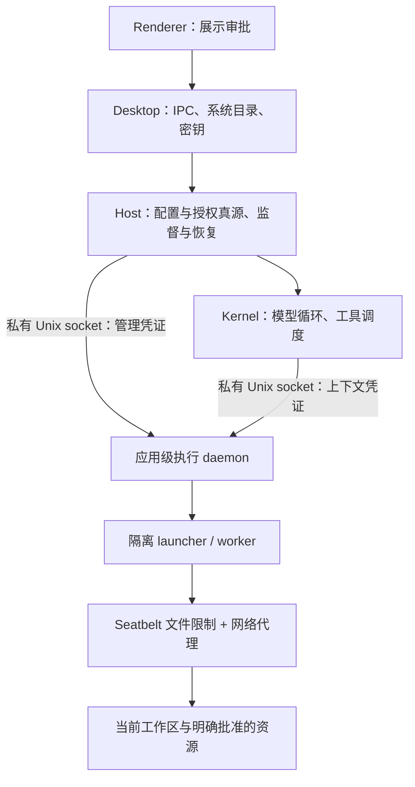

# 沙箱技术架构

## 职责与信任边界

Nuum 使用一个应用级执行 daemon，管理多个 Nunu 的执行上下文。daemon 的拆分用于职责与生命周期管理；真正的访问限制由 OS 沙箱实施。

| 层 | 实现职责 | 边界 |
|---|---|---|
| Desktop | 启动 Host，提供系统文稿与私有数据路径，safeStorage 保存密钥 | 不接管工具执行或授权匹配 |
| Host | 分配工作区、保存 Nunu 配置、处理审批、监督 daemon、恢复原会话结果 | 唯一授权真源；RunWorkCLI 也走 daemon |
| Kernel | 模型循环、工具选择、提交请求和获取结果 | 仅持当前上下文凭证，不能注册上下文或批准自己 |
| daemon | 认证、请求去重、审批状态、取消、执行上下文及输出管理 | 不把模型输入当作已授权策略 |
| launcher / worker | 每上下文的受限工具环境，普通 shell 会话复用 | 外部操作使用临时独立上下文，结束后撤销 |
| OS 隔离 | 强制限制文件、网络等系统访问 | 当前只验证 macOS；不可用时拒绝执行，无直接执行降级 |

Host/Kernel 不导入 executor 实现，通过 `@nuum/protocol` 的跨进程契约调用。共享类型不能替代 daemon 端验证。

## 通信与凭证

执行服务使用私有 Unix socket 上的 HTTP `POST /rpc`，不开放公共 TCP 服务。请求携带 daemon 实例 ID 与 Bearer 凭证。实例改变后旧请求不能直接重放。

Host 私有目录的 `executor/owner.json` 保存管理凭证和 socket 路径；`discovery.json` 保存实例与 PID 等发现信息。私有目录权限为 0700，凭证文件和 socket 为 0600。发现文件不是授权本身：接管时必须通过凭证、实例与 PID 核验。Kernel 获取单独的上下文凭证，不能调用注册、审批、确认接收和关机管理操作。

Host 注册的上下文包含 agentId、workspaceId、规范化根路径、工具集合、命令偏好、网络目标、外部授权、策略摘要及原 run/session/task 归属。撤销或暂停使原凭证失效。模型不能修改这些字段。

## 执行与审批

1. Host 按个人或房间任务选择工作区，注册上下文；Kernel 提交带稳定执行 ID 的工具请求。
2. daemon 核验实例、上下文、工具集合和 run 归属，检查当前任务的拒绝记录。
3. 普通工作区操作在原沙箱执行。网络或外部操作需要已有授权覆盖，否则返回 approval 状态。
4. Host 将审批投影到 UI。用户长期允许时，Host 先保存配置，再通知 daemon；过期或已取消请求不能通过迟到审批复活。
5. 外部操作在执行前重新规范化路径和计算所需规则，与批准时的规则比较；随后建立临时受限上下文执行。
6. 完成结果关联原执行 ID 和会话。写回原 JSONL 后才确认接收，避免把卡片输出写入私聊或重复交付。

临时外部上下文继承当前已批准网络能力，再加本次资源；额外文件权限不会传回普通持久 shell。外部 shell 为一次性 `/bin/bash --noprofile --norc -c`，固定系统 PATH，120 秒超时、100 KB 输出上限。它与每个 Nunu 的普通长驻 shell 不同。

## OS 隔离范围

当前使用固定版本 `@anthropic-ai/sandbox-runtime@0.0.80`，macOS 通过 Seatbelt（sandbox-exec 装载策略）和目标受限代理实施限制。

- 默认可读写当前工作区和专用 scratch。HOME 指向工作区，TMPDIR 指向 scratch/tmp。
- 系统运行库、系统工具、证书与打包 worker 等必要路径只读。工作区不可逃逸指用户资源边界，并不表示看不到系统运行文件。
- 工具默认断网；网络授权使用精确 hostname:80 或 hostname:443，不接受通配域名、任意端口或关闭沙箱。
- 外部用户路径必须在主目录的明确子路径内；不能申请整个主目录、Nuum 私有配置/密钥目录或包含它们的祖先目录。
- 工作区和外部目标进行真实路径核验；新增文件只允许最后一段不存在，父目录必须存在。悬空符号链接不作为可授权目标。
- API 模型请求由 Kernel 的模型链路负责，不属于工具网络授权；工具断网不会阻止向模型发送请求。

路径重检与脚本摘要不是完整依赖图冻结，也不保证消除所有并发文件变更竞态。OS 资源限制仍是实际执行的强制边界。

## 生命周期与结果恢复

参考本地 Grokbot 重建源码的监督、接管和取消语义，使用本地 socket 适配 Nuum。没有复制云端 Gateway/SSE/VNC。

| 场景 | 当前行为 |
|---|---|
| 启动发现已有 daemon | 认证身份；有活跃执行或未确认结果则接管，空闲可替换 |
| 监督连接中断 | 不自动取消已接受执行；失去 Host 联系超过 5 秒拒绝新的非管理请求，可查询已接受请求 |
| Host/Kernel 恢复 | 核验工作区、授权摘要、成员代际和能力目录；失效上下文停止执行并轮换凭证；结果归还原会话 |
| daemon 意外退出 | Host 每秒探测，连续故障最多尝试 5 次，另限制一分钟 5 次重启；不自动重放命令 |
| 存活但无法认证/无响应 | 不依据磁盘 PID 强杀，不启动第二个执行器替代 |
| 监督器 detach | 停止监督，不杀 daemon |
| 无 Host 的空闲实例 | 无执行及未确认结果时，约 30 秒后回收 |
| 显式取消、撤销、退出 | 中止执行并清理隔离进程；TERM 后配置约 2 秒 KILL 回退 |
| 关闭窗口 | 应用后台生命周期继续；退出应用才关闭服务 |

执行记录与去重状态在 daemon 内存中；JSONL 仍是会话真源。存活 daemon 的未交付结果可以恢复，daemon 自身崩溃前未交付的结果不保证恢复。未知结果不能自动重跑；模型回合需用户显式继续。当前容量为 128 个未确认结果、10 万条已确认 ID，超限拒绝新执行。

进程组清理是尽力而为。主动脱离进程组的后代可能存活，继续消耗资源或修改已授权工作区；实测其文件/网络限制仍继承。这不是虚拟机或 cgroup 的全后代销毁保证。

## 调度与演进

没有新增目录锁、文件锁或分布式锁。继续使用 Host 单实例约束、每 Nunu 执行槽、已有共享工作根调度约束和 AgentStore 串行写入链。断连不能被当作执行已结束而提前释放执行中的调度约束。

本期没有远端执行服务、云端模型循环、远程桌面、跨云认证或持久任务服务。进程协议提供未来增加执行目标的边界，但本地路径和权限不能直接当成云端资源。

## 代码入口

| 位置 | 用途 |
|---|---|
| `packages/host/src/executor-client.ts` | 发现、认证、监督、接管、停止 |
| `packages/host/src/runtime.ts`、`execution-recovery.ts` | 上下文与审批、任务身份、结果恢复 |
| `packages/host/src/workspaces.ts` | 工作区目录及稳定归属 |
| `packages/protocol/src/execution.ts`、`execution-client.ts` | 请求、上下文、结果、RPC |
| `packages/protocol/src/permission-rules.ts` | 外部授权 schema、匹配与拒绝标识 |
| `packages/executor/src/server.ts`、`ledger.ts` | 认证、审批、去重、状态与取消 |
| `packages/executor/src/external-access.ts` | 路径和摘要核验、授权构造 |
| `packages/executor/src/runner.ts`、`worker.ts` | 隔离环境、工具、临时外部执行 |
| `packages/sandbox/src/isolated-launcher.ts` | 加载 sandbox-runtime 策略 |

验证记录见[权限改造验收](../reviews/2026-10-22-per-agent-permissions.md)。
